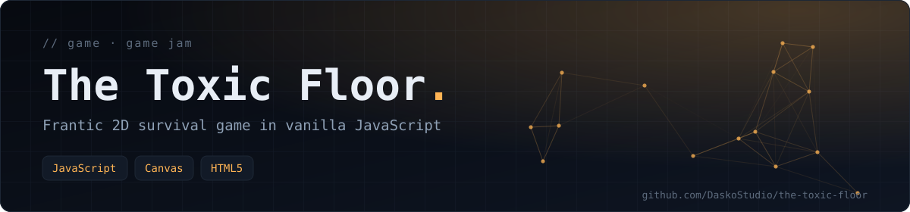
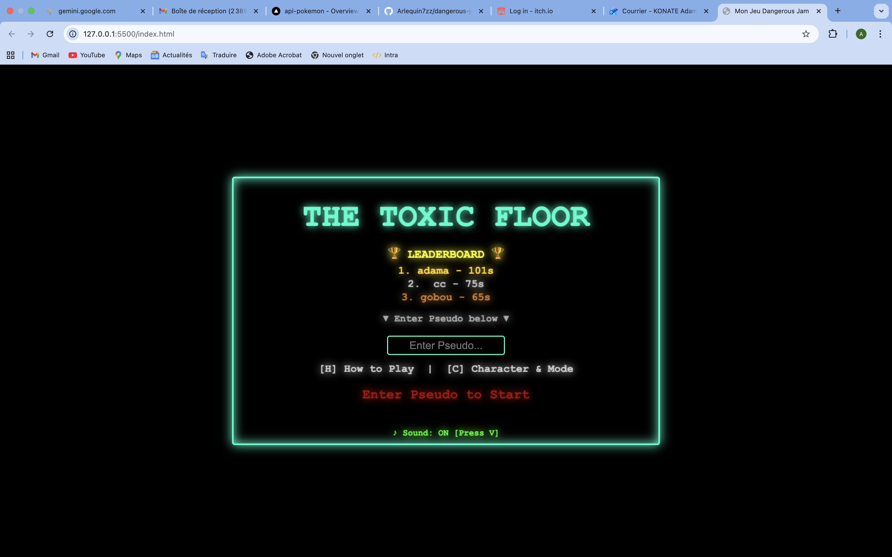
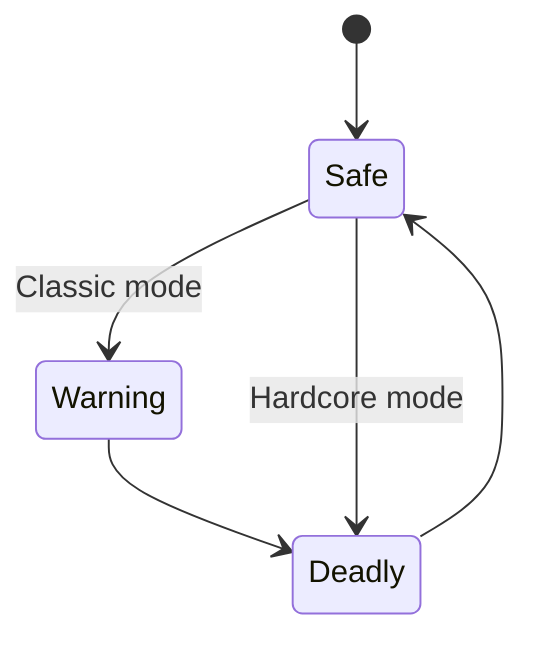

<div align="center">



**A frantic 2D survival game: stay alive as long as you can, dodge waves of enemies and projectiles, and never touch the floor when it turns toxic. Pure JavaScript on an HTML5 canvas, built during a game jam.**

  

[Gameplay](#-gameplay) · [Features](#-features) · [Getting started](#-getting-started) · [Built with](#-built-with)

</div>



## 🎮 Gameplay



The concept is simple; surviving is not. The colour of the arena floor changes constantly and tells you its state:

- 🟩 **Green** — the floor is safe.
- 🟧 **Orange** — warning! The floor is about to become deadly. Get ready to jump or position yourself higher.
- 🟥 **Red** — danger! Touching the floor deals continuous damage.

More and more varied enemies appear as time passes. Power-ups help you in the fight.

## 🕹️ Controls

| Key | Action |
|---|---|
| `WASD`/`ZQSD` or arrow keys | Move |
| `SHIFT` | Dash (quick dodge) |
| `V` | Toggle sound |
| `SPACE` / `ENTER` | Start the game / continue |
| `H` (menu) | Show instructions |
| `C` (menu) | Choose character and mode |

## ✨ Features

- **Local leaderboard** — your best score is saved in your browser (`localStorage`).
- **Three characters** with different speeds.
- **Two game modes**
  - **Classic** — the base experience, with warning phases.
  - **Hardcore** — the floor goes straight from safe to toxic, with no warning.
- **Progressive difficulty** — the game gets faster and harder as your survival time grows.
- **Dynamic visuals** — the arena outline pulses with the music.
- **Chaotic events** — system "corruptions" can invert the screen colours at any time.
- **Wave system** — survive successive waves of enemies.

## 👾 Characters

Pick your survivor from the `Character & Mode` menu (`C`).

| Character | Speed | Play style |
|---|---|---|
| 👻 Ghost | 8 | Balanced |
| 🤖 Robot | 6 | Slow — a challenge for dodging experts |
| 👽 Alien | 10 | Fast — gets you out of trouble quickly |

## 🚀 Getting started

The game runs directly in a web browser. Keep the files together:

- `index.html`
- `src/` — `script.js`, `player.js`, `enemies.js`, `logic.js`
- `assets/` — images and music

Open `index.html` in your browser (Chrome, Firefox…).

> [!TIP]
> To avoid CORS restrictions when loading assets, serve the folder locally:
>
> ```bash
> python3 -m http.server 8000
> # then open http://localhost:8000
> ```

## 🧰 Built with

- **Engine** — vanilla JavaScript
- **Rendering** — HTML5 Canvas
- **Storage** — Web Storage API (`localStorage`) for scores

## 👥 Credits

- **Music** — `Instru by dasss.m4a`. Many thanks for the energetic soundtrack!
- Developed as a team project during a game jam.

---

<div align="center">

<sub>Built by <a href="https://github.com/DaskoStudio"><b>Konaté Adama</b></a> · <a href="https://github.com/DaskoStudio?tab=repositories">More projects</a></sub>

</div>
